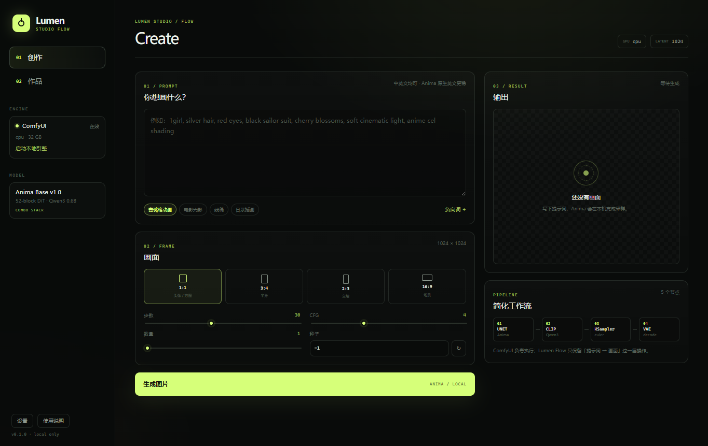

# Lumen Studio Flow

**Lumen Studio Flow** is a separate, focused anime image studio built around a local **ComfyUI + Anima** pipeline.

It is not a replacement for the original Lumen Studio. The original project keeps its multi-engine, reference-library and local-learning workflow. Flow is a new project with a different goal:

```text
one prompt -> one frame -> one local ComfyUI workflow
```



## Why a new project

The original Lumen Studio grew around Diffusers, IP-Adapter references, feet repair and cloud providers. Flow deliberately removes that complexity from the main path:

- ComfyUI does the execution
- Anima + Qwen3 text encoder does the image generation
- Lumen Studio Flow only exposes the controls a normal user needs
- The generated image is always saved locally

## Features

- Local ComfyUI backend
- Anima Base v1.0 workflow
- Prompt + negative prompt
- 1:1 / 3:4 / 2:3 / 16:9 frames
- Steps / CFG / batch / seed
- Local output gallery
- One-click ComfyUI health check and launch
- No account, no cloud, no remote queue

## Requirements

- Windows 10/11
- ComfyUI (portable or source)
- Python environment for ComfyUI
- Anima model files:

```text
ComfyUI/models/diffusion_models/anima-base-v1.0.safetensors
ComfyUI/models/text_encoders/qwen_3_06b_base.safetensors
ComfyUI/models/vae/qwen_image_vae.safetensors
```

If you use the portable `ComfyUI_windows_portable` layout, point Flow at its root. If you use a source checkout, point Flow at the folder containing `main.py`.

## Reference material

- Bilibili series: https://www.bilibili.com/video/BV1CcuH6sESW
- ComfyUI Anima guide: https://docs.comfy.org/tutorials/image/anima/anima
- Anima workflow template: https://github.com/Comfy-Org/workflow_templates
- Anima model card: https://huggingface.co/circlestone-labs/Anima

The Flow workflow is a simplified subset of the official Anima template:
UNET + Qwen3 CLIP + VAE + KSampler + SaveImage. No custom nodes are required.

## Model sources

- Anima: https://huggingface.co/circlestone-labs/Anima
- ComfyUI: https://github.com/Comfy-Org/ComfyUI
- ComfyUI Anima workflows: https://github.com/Comfy-Org/workflow_templates

The model files are not included in this repository.

## Development

```powershell
# from this folder
npm install
npm run dev
```

The app expects a running ComfyUI at `http://127.0.0.1:8188` unless launched from the app's "start local engine" button.

## Simplified workflow

The app submits this graph to ComfyUI:

```text
UNETLoader(Anima)
CLIPLoader(Qwen3, stable_diffusion)
VAELoader(qwen_image_vae)
CLIPTextEncode(positive / negative)
EmptyLatentImage
KSampler(euler / simple)
VAEDecode
SaveImage
```

No custom nodes are required for the base workflow.

## Differences from the original Lumen Studio

| | Lumen Studio | Lumen Studio Flow |
| --- | --- | --- |
| Main engine | Diffusers / cloud / ComfyUI | ComfyUI first |
| Anime model | MeinaMix | Anima |
| UI | Full studio | One-screen flow |
| References | Character / body library | Later, optional |
| Training | Not included | Not included |
| Goal | Platform | Focused anime generator |

## License

MIT for the Flow app. ComfyUI, Anima and model files follow their own licenses.

## Disclaimer

Use the software at your own risk. You are responsible for the prompts you enter, the images you generate and the rights attached to any reference or model you use.
