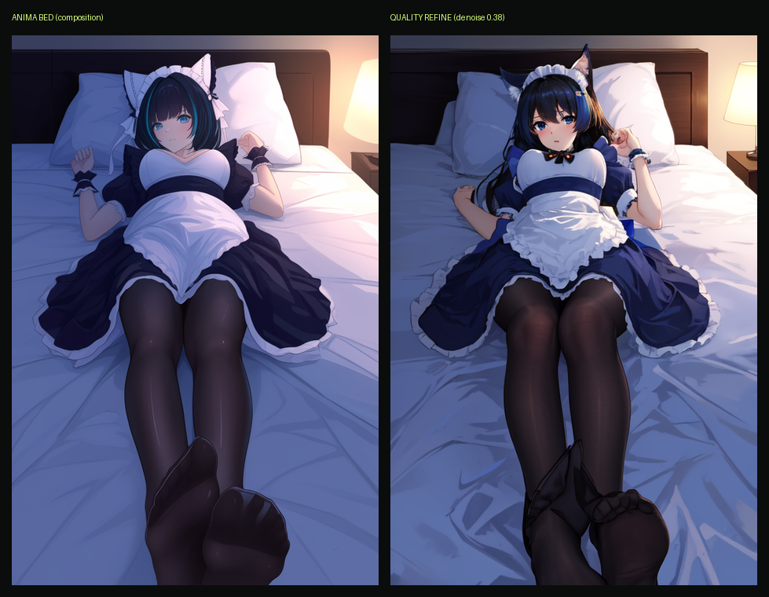

# 保留 Anima 构图，提升作画质量

你喜欢的 Anima 床上柴郡：

- 角色正确
- 视角/构图正确
- 但线条和渲染像新手

解决方法不是重新抽卡，而是：

```text
Anima 原图 -> 低 denoise 质量重绘 -> 保留构图，只提升渲染
```

## 实测



参数：

```text
模型模式：标准 Checkpoint
Checkpoint：MeinaMix-V10
LoRA：make25d_type2_v100
LoRA 强度：0.55
Denoise：0.38
Steps：20
CFG：6
分辨率：512×768
参考方式：img2img
```

prompt 保留：

```text
cheshire (azur lane)
black hair, blue highlights, blue eyes
fake animal ears, maid headdress, maid
lying on bed, head on pillow
bedroom, night, lamp light
```

结果：

- 姿势、构图、角色位置基本保留
- 头发、皮肤、布料、灯光明显提升
- 脚部仍然不是完美，但不再是大块黑块

## Flow 里怎么做

1. 生成 Anima 图
2. 点结果下方「以当前图重绘」
3. 设置里切换：
   - 标准 Checkpoint
   - MeinaMix
   - Galgame 3D 风格
4. 参考强度改成 38%
5. 再生成

## 注意

- denoise 太高会改变构图和角色
- 38% 是保留构图和提升质量的平衡点
- 这个流程适合“构图满意，画质不满意”的图
- 不适合“角色/构图本身就不对”的图
