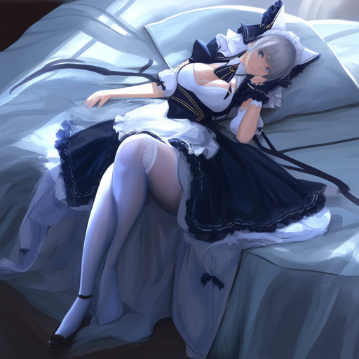

# Lumen Studio Flow v0.1.4

角色识别与同名消歧。

## 新增

### 角色识别

内置 2383 个公开 Anima 角色条目，输入：

```text
我想画一个2.5D的躺在床上的柴郡
```

Flow 会识别：

```text
cheshire (azur lane)
azur lane
2.5D 厚涂 + @wlop / @mika_pikazo
lying, bed
```

### 同名角色消歧

输入“爱丽丝”会列出不同作品：

- 东方Project
- 蔚蓝档案
- 爱丽丝梦游仙境
- 绝区零
- 刀剑神域
- NIKKE

用户点选后才写入角色和作品。

### 角色 + 风格 + 动作 + 场景

生成器同时识别：

- 角色名
- 作品
- 2.5D / 赛璐珞 / 黑白漫画 / 水墨
- 躺、坐、站、看书
- 床、樱花、森林、长椅、海边

## 实测

提示词：

```text
masterpiece, best quality, score_7, safe, 1girl, solo,
cheshire (azur lane), azur lane, @wlop, @mika_pikazo,
lying on bed, full body, face visible, white hair, blue eyes,
black maid outfit, white apron, painterly rendering,
soft volumetric lighting, 2.5D
```

本地 ComfyUI + Anima 出图通过。



## 限制

- 中文别名只补了常见角色
- 角色是否像，取决于 Anima 是否认识该 tag
- 这是角色名解析，不是图像识别
- 同名角色由用户选择，不自动猜

## 数据来源

- Comfyui-Anima-Wardrobe-V4（MIT 数据）
- 只使用文本字段，不包含角色缩略图
