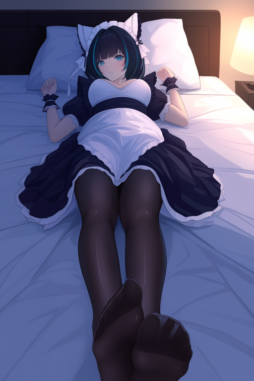
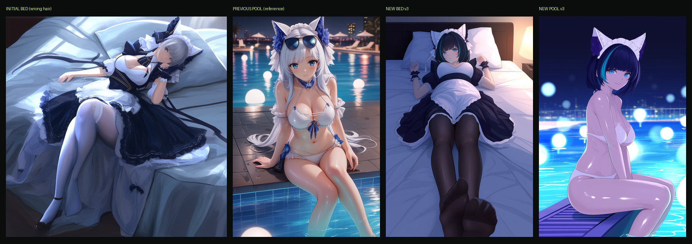

# Lumen Studio Flow v0.1.8

柴郡外观与 2.5D 画风修正。

## 修正

### 柴郡不是白发

角色库里的柴郡外观是：

```text
black hair
streaked hair
blue highlights
blue eyes
fake animal ears
maid headdress
short hair
```

0.1.8 起，识别到角色后会自动把这些外观 tag 加入普通标签，不再只写角色名。

### 2.5D 不再是厚涂油画

`2.5D` 风格改成：

```text
semi-realistic anime
soft cel shading
clean anime rendering
delicate lineart
soft gradients
glossy skin
```

去掉：

```text
thick brushwork
painterly oil rendering
```

并增加负面词：

```text
oil painting, impasto, thick brush strokes, 3d render, photorealistic
```

## 两张修正版

床上：



泳池泳装：


## 对比

初版床上、之前泳池、新版床上、新版泳池：



- 初版：白发错误，但床和女仆装对
- 之前泳池：白发错误、墨镜、参考图棕发影响
- 新版床上：黑发 + 蓝色挑染、猫耳、女仆、床、2.5D 柔和渲染
- 新版泳池：黑发 + 蓝色挑染、猫耳、白比基尼、泳池、2.5D

## 仍待解决

- 床版的脚部/黑丝占比过大，脚部细节模糊
- 泳池版皮肤高光偏强
- 角色脸仍偏通用
- Face Detailer 还没有真正接入
- Anima Ref Adapter 已安装，CPU 太慢，建议 GPU

## 下载

不包含模型、ComfyUI 本体或第三方图片。
