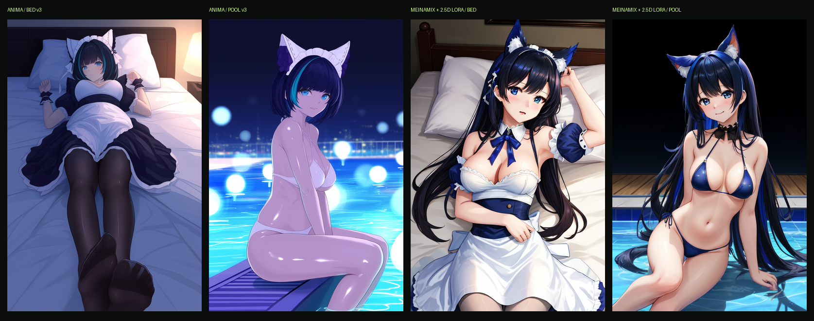

# Lumen Studio Flow v0.1.9

Galgame / 2.5D 风格 LoRA 与画风分层。

## 新增

### Galgame 3D 风格

风格栏新增：

```text
Galgame 3D
```

自动使用：

```text
Checkpoint + make25d_type2_v100 LoRA
```

适用于：

- Galgame 立绘感
- 2.5D 半写实
- 头发和皮肤高光
- 比 Anima 默认更完整的背景

### 风格 LoRA 不再绑定全局设置

风格 chip 可以带自己的 LoRA：

```text
gal-3d -> make25d_type2_v100.safetensors
strength 0.55
```

只有 Checkpoint 模式会生效；Anima 模式不会误加载 SD1.5 LoRA。

## 实测对比

Anima 默认 vs MeinaMix + 2.5D LoRA：



结论：

- MeinaMix + LoRA 的皮肤、头发、背景更接近 Galgame 3D
- 但脸仍然偏通用
- 强度 0.55 是当前比较平衡的值
- LoRA 过高会出现塑料皮肤和过度胸部

## 角色修正

柴郡外观自动加入：

```text
black hair
streaked hair
blue highlights
blue eyes
fake animal ears
maid headdress
short hair
```

不再出现白发错误。

## 仍待解决

- 角色脸一致性
- 风格训练数据集
- GPU 上的 Anima Ref Adapter
- Face Detailer

## 下载

不包含模型、LoRA、ComfyUI 本体或第三方图片。
