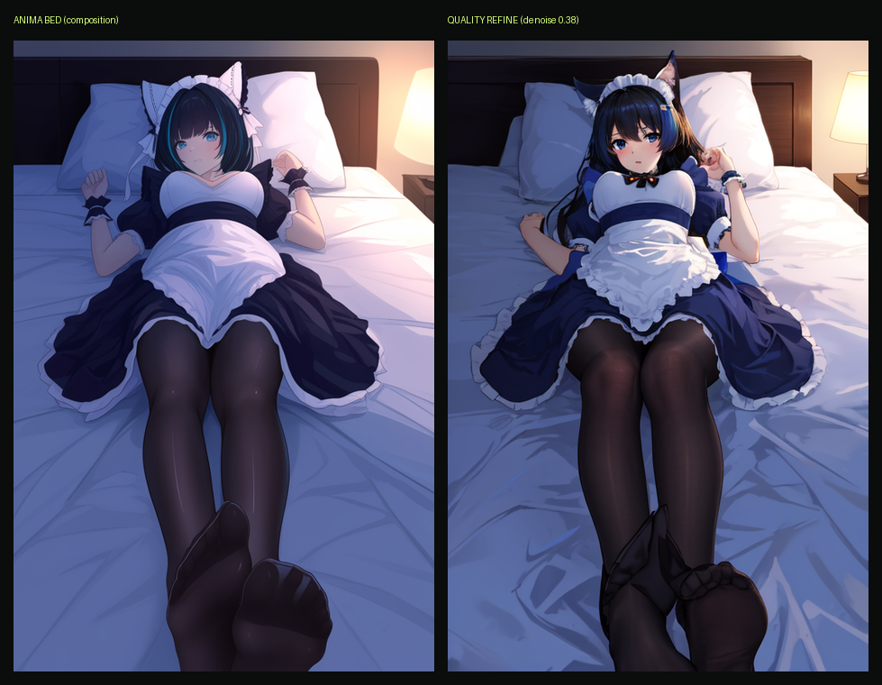

# Lumen Studio Flow v0.2.1

保留构图的质量重绘，以及画师批次入库。

## 新增

### 以当前图重绘

结果下方新增按钮：

```text
以当前图重绘
```

点击后：

- 当前图自动放进参考图
- 参考方式切到 img2img
- 参考强度设为 38%
- 选 Checkpoint + Galgame 3D 再生成

适用于：

- Anima 构图/角色正确，但作画质量不够
- 不想重新抽卡
- 想保留姿势和构图

实测：



### 画师批次入库

```text
training/scripts/ingest_batch.py
```

支持按批次接收：

```powershell
python training/scripts/ingest_batch.py `
  --artist Ririko `
  --style flat_cel `
  --batch 01 `
  --files C:\incoming\*.jpg
```

输出：

- `training/inbox/flat_cel/batch_01/`
- `batch_manifest.jsonl`
- `batch_sheet.png`
- 近似重复标记

### 视角一致性测试

```powershell
python training/scripts/eval_character_consistency.py --matrix views
```

四个视角：

```text
front / three_quarter / side / above
```

专门检查 LoRA 视角是否死板。

## 当前状态

- Anima + 质量重绘：构图保留，质量提升
- LoRA 风格：质量好，但角色不对
- 角色脸一致性：未解决
- 正式风格 LoRA：等待 Ririko 批次数据

## 下载

训练集、参考图、LoRA 权重不进入发布包。
