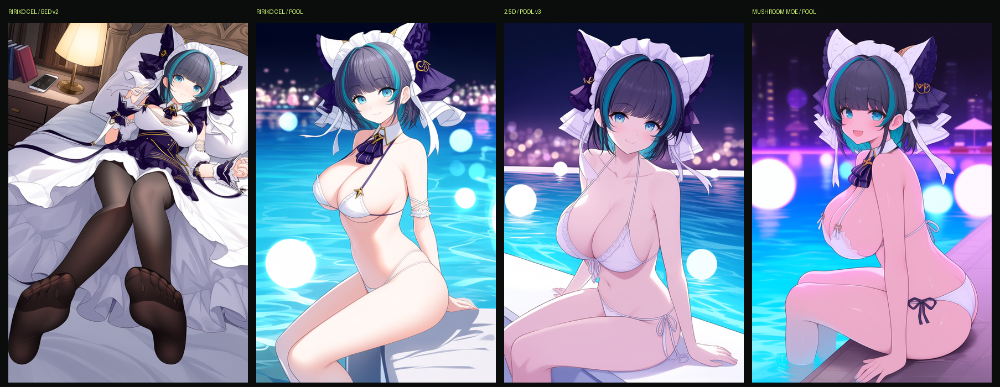

# Lumen Studio Flow v0.2.2

Anima 风格 LoRA 训练、风格反哺软件。

## 新增

### CUDA 训练环境

```text
torch 2.5.1+cu121
RTX 4070 SUPER 12GB
kohya-ss/sd-scripts anima_train_network.py
```

训练环境独立：

```text
F:\DSH WORKSPACE\.venv-train
```

### Anima 风格 LoRA

- Ririko flat-cel：`ririko_anima_v1.safetensors`
- MushroomMirror 萌系：`mushroom_anima_v1.safetensors`

两者放在：

```text
models/loras/
```

### 软件里的风格

新增：

```text
Ririko 赛璐珞
Mushroom 萌系
```

选择风格后，Anima 模式会用对应 LoRA。

### 参考图归档

用户参考图与训练集只保存在 F 盘：

```text
training/_archive/ririko_wechat_reference_backup.zip
```

不进入 GitHub 发布包。

## 当前实测



- Ririko 赛璐珞：床上 / 泳池
- 2.5D：仍是临时版本，偏平
- Mushroom 萌系：泳池测试

## 已知问题

- 2.5D 还没有达到参考图的质感
- 床上脚趾细节仍不够
- Ririko/Mushroom 都只训练了 1 epoch
- 角色脸部仍偏通用

## 下载

不包含 LoRA、训练图片、模型或 ComfyUI 本体。
