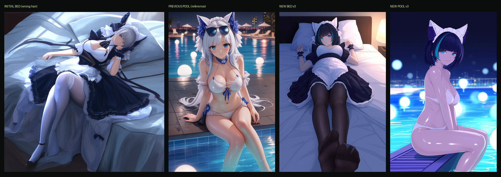
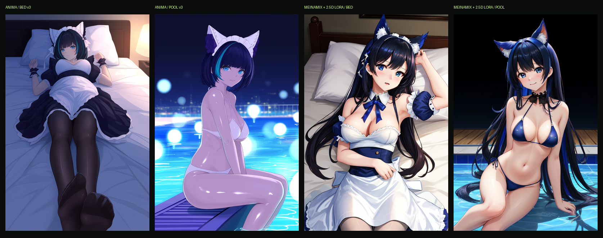

# 2.5D / Galgame 风格 LoRA

## 为什么加

Anima 默认输出偏“平涂动画”，直接 prompt 2.5D 容易变成油画或塑料皮肤。

更适合受众的路线是：

```text
基础 Checkpoint（MeinaMix / SDXL）
+ 2.5D / Galgame 风格 LoRA
+ 角色外观 tags
```

## 当前集成

Flow 的「Galgame 3D」风格使用：

```text
make25d_type2_v100.safetensors
```

来源：

- https://huggingface.co/JujoHotaru/lora
- 2.5D 转换 LoRA，Type2 是标准 2.5D 口味

放置：

```text
ComfyUI/models/loras/make25d_type2_v100.safetensors
```

使用：

```text
模型模式：标准 Checkpoint
Checkpoint：MeinaMix-V10
风格：Galgame 3D
```

Flow 会自动加：

```text
LoraLoader
strength_model 0.55
strength_clip 0.55
```

## 实测

Anima 默认床上/泳池：



MeinaMix + 2.5D LoRA：



结果：

- 皮肤、头发高光更接近 Galgame/3D
- 角色黑发、蓝挑染、猫耳都能保留
- 背景和构图比 Anima 更完整
- 但脸仍然偏通用
- LoRA 强度过高会出现塑料皮肤/过度胸部

## 推荐参数

```text
Checkpoint: MeinaMix-V10
LoRA strength: 0.45–0.65
Steps: 20–30
CFG: 6–7
Sampler: euler / euler_a
Resolution: 512×768 起
```

## 训练自己的风格

如果要做“以参考图为基准”的风格训练，需要：

1. 10–30 张同风格图片，而不是 1 张参考图
2. 裁切/去重/统一分辨率
3. 用 Kohya / diffusers 训练 SD1.5 或 Anima LoRA
4. 用固定 seed 做 A/B 对比

目前 CPU 环境不适合训练；需要 GPU。

## 许可

- `make25d` 权重由 JujoHotaru 发布，遵循其模型页许可
- Flow 不打包任何 LoRA 权重
- 用户需自行确认商用/再分发权限
